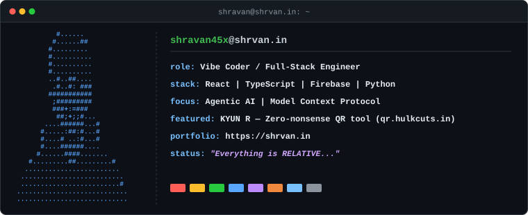

<picture>
  <source media="(prefers-color-scheme: dark)" srcset="dark_mode.svg" />
  <source media="(prefers-color-scheme: light)" srcset="light_mode.svg" />
  
</picture>

 

---

### `~/about`

Hi, my name is Shrvan and I'm a Vibe Coder.

> *"The only purpose of my life is to have Free Will, so I do what I like to do! Coding is not my passion or anything. I code (vibe code) because I can, not because I have to!"*

Full-stack engineer crafting production web apps with **React**, **TypeScript**, and **Firebase**. Currently exploring **Agentic AI**, **Model Context Protocol (MCP)**, and autonomous multi-agent orchestration.

---

### `~/projects`

- ⚡ **[KYUN R](https://www.qr.hulkcuts.in)** — Clean, zero-nonsense QR generation utility built without bloated 3rd-party dependencies. Completely open source.
- 🌐 **[shrvan.in](https://shrvan.in)** — Personal website & interactive canvas.
- 🔒 *All my other projects are kinda classified so there is nothing to display here...*

---

### `~/stack`

- **Core:** TypeScript, JavaScript, Python
- **Frontend:** React, Vite, Vanilla CSS
- **Backend & Cloud:** Firebase (Firestore, Auth, Cloud Functions), Vercel, GCP
- **AI & Systems:** Agentic AI, Model Context Protocol (MCP), Multi-Agent Swarms

---

### `~/sysinfo`

  
  

---

### `~/snake.exe`

<picture>
  <source media="(prefers-color-scheme: dark)" srcset="https://raw.githubusercontent.com/shravan45x/shravan45x/output/github-contribution-grid-snake-dark.svg" />
  <source media="(prefers-color-scheme: light)" srcset="https://raw.githubusercontent.com/shravan45x/shravan45x/output/github-contribution-grid-snake.svg" />
  
</picture>

---

<code>Everything is RELATIVE...</code>

